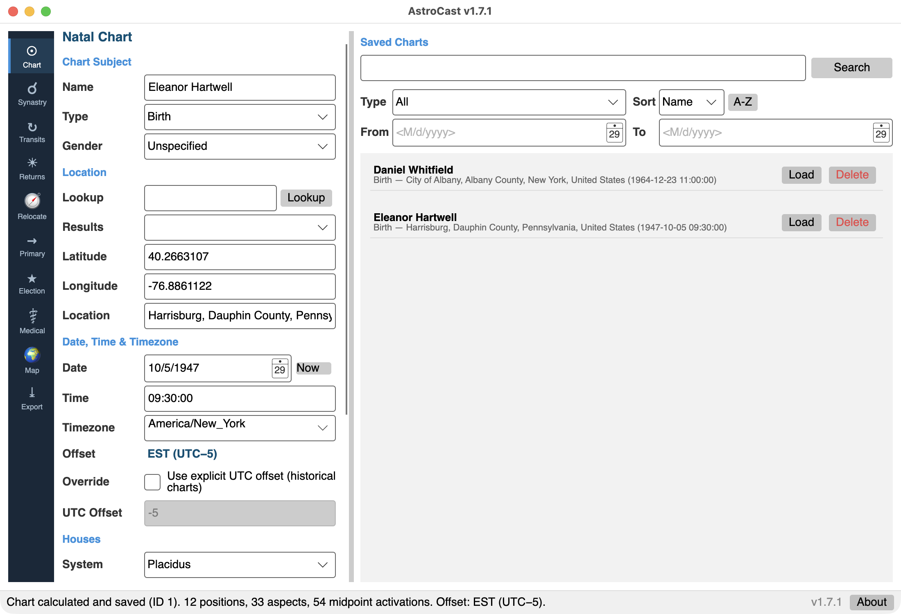

# AstroCast

AstroCast is a desktop astrology program for Windows and macOS. It casts charts on the Swiss
Ephemeris in the tropical zodiac, analyses them with the traditional and modern techniques of
Western astrology, and writes every result out as a Markdown report that reads well on its own
or as the input to an AI interpretation. A companion prompt library turns those reports into
written readings.

AstroCast is free software under the GNU Affero General Public License, version 3 or later.

## What it does

The program has ten panels, in the order of its left-hand bar. Each panel calculates on
screen and exports what it shows.

| Panel | What it calculates | Exports |
|---|---|---|
| Chart | A birth, event or horary chart: positions, houses, aspects, midpoints, dignities, sect, the Moon's condition, Arabic parts, fixed stars, time lords, temperament; optionally the four main asteroids and Black Moon Lilith | Markdown, JSON, PDF; the saved-chart database |
| Synastry | Two charts compared: inter-chart aspects and overlays; the composite chart; the Davison chart | Synastry, Composite and Davison Markdown |
| Transits | A period's transits, secondary progressions, solar arcs and primary directions, in any combination; a transit timeline; a daily horoscope; a return-and-ingress timeline | Report, Timeline and Daily Markdown |
| Returns | Solar, lunar and planetary returns; a planet's cycle timeline; mundane series: aspects between two planets, Great Conjunctions, ingresses, lunations, eclipses, synodic cycles | One Markdown export per series |
| Relocate | The birth chart cast at another place | Relocation Markdown |
| Primary | Primary directions for a whole life, Placidus semi-arc, with birth-time sensitivity | Directions Markdown |
| Election | A search of a date range for the best moments for an undertaking, scored | Electional Markdown |
| Medical | Traditional medical astrology: temperament, the health houses, correspondences | Medical Markdown |
| Map | Astrocartography: the angular lines of every body in mundo, with crossings, on a base map | ACG Markdown |
| Export | The chart exports in one place, Export JSON, Export PDF, and the database backup | — |

Every calculation is done afresh from the Swiss Ephemeris when it is asked for; nothing is
cached. Dates run from 1200 to 2399; dates before 15 October 1582 are read and printed on the
Julian calendar. Time zones come from the IANA database the program carries, so a chart
casts the same on both systems.

Full write-ups of each technique and the rules the engine follows are in
[CLAUDE.md](CLAUDE.md), the project's working contract, under *Astrological Calculation Rules*.

## Install

**Requirements.** Windows 10 or 11 (64-bit), or a Mac with Apple silicon running macOS 15 or
later.

**Windows.** Run the MSI from the
[Releases page](https://github.com/sthornhill008/AstroCast/releases). It installs for the
current user under
`%LOCALAPPDATA%\Thornhill Computer Software\AstroCast`, needs no separate .NET install, and
shows the licence on its first page. The MSI is not Authenticode-signed, so Windows SmartScreen
asks once before it runs: choose *More info*, then *Run anyway*. The saved-chart database and
the logs live beside `AstroCast.exe` in that folder and survive an upgrade.

**macOS.** Open the DMG from the Releases page and drag AstroCast to Applications. The app is
signed with a Developer ID and notarized, so Gatekeeper opens it without a warning. The
database and logs live in `~/Library/Application Support/AstroCast`.

Chapter 2 of the [User Guide](docs/USER_GUIDE.md) has the details for both systems.

**The map's base layer.** The Map panel draws its streets and place names from CARTO's
Voyager tiles, which need a key. Public builds ship without one: the map draws its
astrocartography lines over a blank background and says *Base map unavailable: no CARTO key*.
To add the tiles, request a free key from [CARTO](https://carto.com/basemaps/) (free for
non-commercial use under CARTO's own terms), put it alone in a file named `carto-key.txt`, and
place that file beside `AstroCast.exe` on Windows or in `~/Library/Application Support/AstroCast`
on macOS. The program reads it at its next start.

## First chart

1. On the **Chart** panel, enter a name, search for the birthplace (the time zone fills in
   from it), enter the date and time, and press **Calculate & Save**.
2. Press **Save Markdown** to write the chart report, or open the **Export** panel for the
   JSON and PDF.
3. To read the report with an AI, open the prompt library's guide (below), pick the prompt
   for the export you made, and paste the prompt and the report into a chat.

## The prompt library

Thirty prompts, one per kind of export, each written to read AstroCast's own report format and
to return a written interpretation in a stated method. They are plain Markdown files, licensed
under CC BY-SA 4.0, kept in this repository's [`prompts/`](prompts/README.md) folder. The
[Prompt Library Guide](docs/PROMPT_LIBRARY_GUIDE.md) explains how to make an export, choose a
prompt and submit it.

## Building from source

- .NET 10 SDK (the version in `global.json`), C# 14. On Windows, Visual Studio 2026 or the
  command line; on macOS, the command line or Rider.
- The root holds two solution files, so a bare `dotnet build` stops with MSB1011: name one.
  `dotnet build AstroCast.slnx` builds everything on Windows; `dotnet build AstroCast.Mac.slnx`
  builds everything but the WPF head on macOS.
- `dotnet test tests/AstroCast.Tests` runs the engine and view-model tests;
  `dotnet test tests/AstroCast.UiTests` the headless Avalonia UI tests.
- The Swiss Ephemeris native library and its data files are in the repository (`lib/swisseph/`,
  `ephe/`); nothing else needs installing. A build without a CARTO key file succeeds and says
  so in one message; the resulting app has no base map until a key file is supplied as above.
- The Windows installer is `BuildInstaller.ps1` (WiX 6); the macOS bundle and DMG are
  `build/macos/make-bundle.sh` and `build/macos/package-macos.sh`, with the signing procedure
  in `build/macos/SIGNING.md`.

The [User Guide](docs/USER_GUIDE.md) takes you from installing AstroCast to a finished report,
panel by panel. A maintainer's guide to building, testing and releasing on both systems
(`docs/BUILDING.md`) is being written; until it lands, `CLAUDE.md` holds the build and test
commands and every rule the engine follows.

## Contributing

See [CONTRIBUTING.md](CONTRIBUTING.md) for the conventions a change must keep: documented
public members, culture-independent output, the golden-file and Tier B testing pattern, and
Conventional Commits. `CLAUDE.md` is the full contract.

## Licence

AstroCast is licensed under the GNU Affero General Public License, version 3 or (at your
option) any later version ([LICENSE](LICENSE)). It uses the Swiss Ephemeris under that
library's AGPL option. Every third-party package and data source, with its licence, is listed
in [THIRD-PARTY-NOTICES.md](THIRD-PARTY-NOTICES.md); [docs/LICENSING.md](docs/LICENSING.md)
sets out what that means in plain terms. The program's About window carries the same notices.

Copyright © 2026 Thornhill Computer Software.
