# AstroCast User Guide

*For AstroCast 1.7.1 and later, on Windows and macOS.*

This guide takes you from installing AstroCast to a finished report. The first three chapters
are enough to cast your first chart; the rest go panel by panel. Every button, box and setting
is named as the program prints it.

**Contents**

1. What AstroCast is
2. Install
3. Your first chart
4. The Chart panel in full
5. Transits & Progressions
6. Returns and the mundane series
7. Synastry, Composite & Davison; Relocation; Primary Directions
8. Election; Medical; the Map
9. Export & Backup
10. The rules you will meet
- Appendix: the exports and the prompts that read them

---

## 1. What AstroCast is

AstroCast is a desktop program that casts astrological charts on the Swiss Ephemeris and
analyses them with the techniques of Western astrology, traditional and modern. It is one
program with two faces: a Windows version and a macOS version that share the same engine, the
same panels and the same reports, so a chart casts the same on either machine.

| Windows | macOS |
|---|---|
| 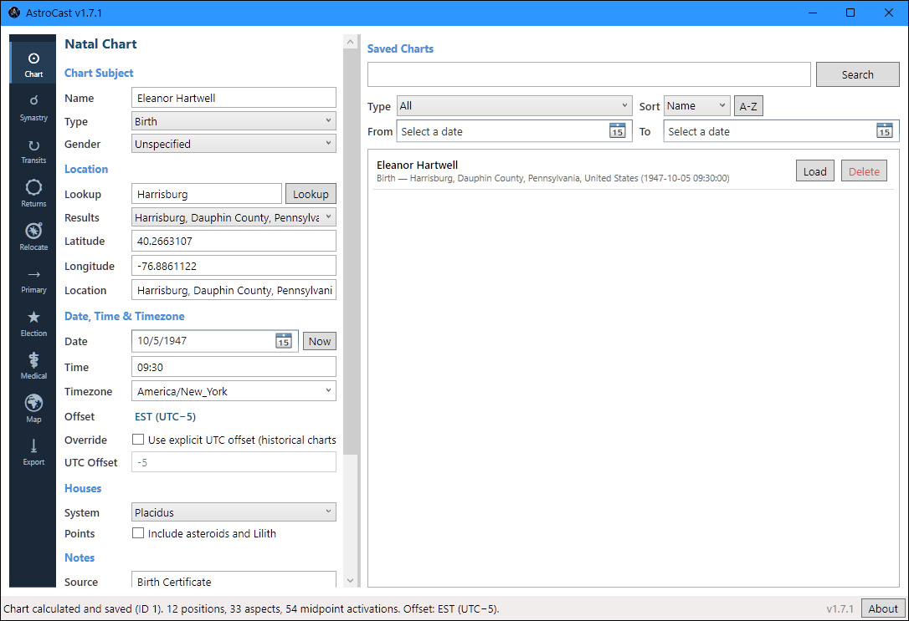 | 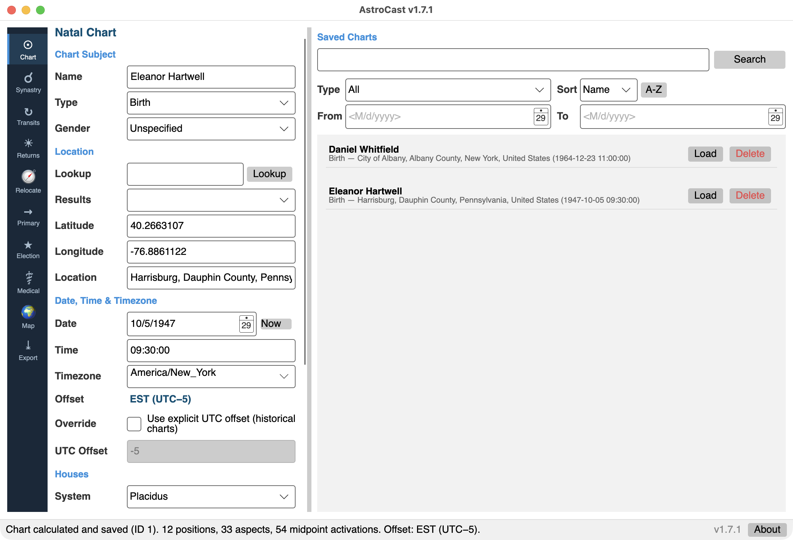 |

*The Chart panel on Windows and on macOS, the same chart in each.*

Everything AstroCast calculates it also writes out as a **Markdown report**: a plain text file
with headings and tables that you can read as it is, print, or hand to an AI chat for a written
interpretation. A companion library of prompts, one for each kind of report, is written for
exactly that; the appendix lists which prompt reads which report, and the prompt library has a
guide of its own, the [Prompt Library Guide](PROMPT_LIBRARY_GUIDE.md).

The program has ten panels, listed down the left-hand bar in this order:

| Panel | What it does |
|---|---|
| **Chart** | Enter a birth, event or horary chart; calculate and save it; export it |
| **Synastry** | Compare two charts; cast their composite chart and their Davison chart |
| **Transits** | Transits, secondary progressions, solar arcs and primary directions over a period; a transit timeline; a daily horoscope; a return-and-ingress timeline |
| **Returns** | Solar, lunar and planetary returns; a planet's cycle; mundane series (Great Conjunctions, synodic cycles, ingresses, lunations, eclipses, aspects between two planets) |
| **Relocate** | The birth chart cast at another place |
| **Primary** | Primary directions for a whole life |
| **Election** | Search a date range for the best moments for an undertaking |
| **Medical** | Traditional medical astrology |
| **Map** | Astrocartography: the angular lines of every body on a world map |
| **Export** | Every export in one place; the chart PDF; the database backup; your saved charts |

A keyboard shortcut opens each panel: Alt+1 Chart, Alt+2 Synastry, Alt+3 Transits, Alt+4
Returns, Alt+9 Relocate, Alt+0 Primary, Alt+5 Election, Alt+6 Medical, Alt+8 Map, Alt+7
Export. (On the Mac, hold Option for Alt.)

Charts you save go into AstroCast's own database on your computer, and the **Saved Charts**
list on the right of the window shows them whatever panel is open. Two things use the
internet: the place lookup, which asks OpenStreetMap's Nominatim service for a city's
coordinates, and the map's base-layer tiles, which need a key you supply (chapter 8).
Everything else happens on your machine.

AstroCast is free software under the GNU Affero General Public License. The **About** button at
the right of the status bar shows the version, the licence and the third-party notices.

| Windows | macOS |
|---|---|
| 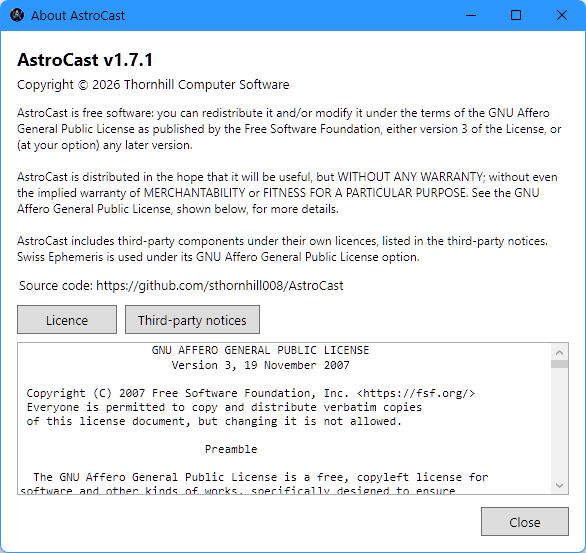 | 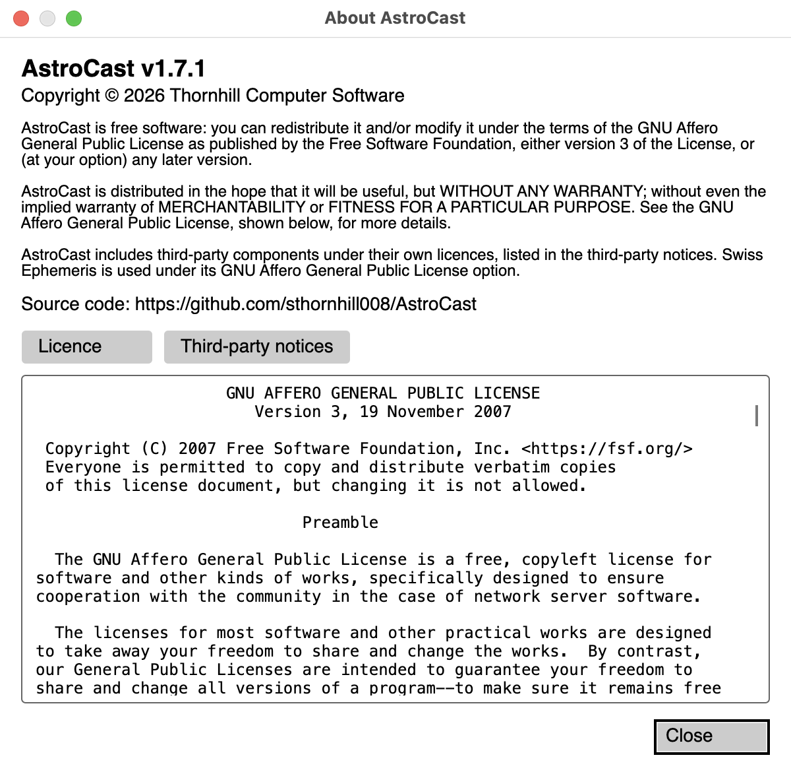 |

*The About window on Windows and on macOS: the version, the licence and the third-party notices.*

---

## 2. Install

### Windows

1. Download the MSI from the Releases page and run it.
2. Windows SmartScreen will say the publisher is unknown, because the installer is not
   signed with a Windows certificate. Choose **More info**, then **Run anyway**.
3. Accept the licence shown on the installer's first page and finish.

AstroCast installs for the current user only, under
`%LOCALAPPDATA%\Thornhill Computer Software\AstroCast`, and needs nothing else: the .NET
runtime and the Swiss Ephemeris are inside. A newer version installs over an older one and
keeps your saved charts.

**Where things live on Windows**

| What | Where |
|---|---|
| The program | `%LOCALAPPDATA%\Thornhill Computer Software\AstroCast\AstroCast.exe` |
| Your saved charts | `astrocast.db` in that same folder |
| Logs | the `logs` folder in that same folder |
| The map key (optional) | `carto-key.txt` in that same folder |

### macOS

1. Download the DMG from the Releases page and open it.
2. Drag **AstroCast** into **Applications**.
3. Open it from Applications or Launchpad. The app is signed and notarized, so macOS opens it
   without a warning.

**Where things live on macOS**

| What | Where |
|---|---|
| The program | `/Applications/AstroCast.app` |
| Your saved charts | `~/Library/Application Support/AstroCast/astrocast.db` |
| Logs | `~/Library/Application Support/AstroCast/logs` |
| The map key (optional) | `~/Library/Application Support/AstroCast/carto-key.txt` |

The `Application Support` folder and the database are created the first time the app runs.
(`~` is your home folder; in the Finder, hold Option and open the **Go** menu to see
**Library**.)

### The map's base layer

The Map panel draws street maps under its astrocartography lines using tiles from CARTO, a map
service that needs a key. AstroCast ships without one: the map works, draws every line and
marker, and says *Base map unavailable: no CARTO key* under its legend. If you want the
street map, chapter 8 explains how to get a free key and where to put it.

### Upgrading

Install the new version over the old one. Your charts, settings and logs are kept; the
installer never replaces the database.

---

## 3. Your first chart

*The Chart panel after Calculate & Save: Eleanor Hartwell's form on the left, the Saved Charts list on the right, the status bar's confirmation at the bottom.*

Open AstroCast. The **Chart** panel is showing, with the title *Natal Chart*. Let us cast a
chart for an invented person, Eleanor Hartwell, born 5 October 1947 at 9:30 in the morning in
Harrisburg, Pennsylvania.

**Chart Subject.** Type the name, `Eleanor Hartwell`, in **Name**. Leave **Type** at *Birth*
and **Gender** as you please.

**Location.** Type `Harrisburg, PA` in the **Lookup** box and press **Lookup**. A list of
matching places appears in **Results**; choose *Harrisburg, Pennsylvania, United States*. The
**Latitude**, **Longitude** and **Location** boxes fill in, and so does the **Timezone**
below, with `America/New_York`.

**Date, Time & Timezone.** Set the **Date** to 5 October 1947 with the date picker. Type
`09:30` in **Time** (the box takes `HH:mm` or `HH:mm:ss`, 24-hour). The **Timezone** is already
right; the **Offset** line below it shows the UTC offset the program has worked out for that
date and place.

**Houses.** Leave **System** at *Placidus* and **Points** unticked.

**Notes.** Optional. **Source** is where you record where the birth data came from, such as
`Birth Certificate`; the reports print it, and some techniques treat a chart with an
uncertain time differently (chapter 7).

Now press **Calculate & Save** in the **Actions** section. The status bar at the bottom
reports the result: *Chart calculated and saved (ID 1). 12 positions, … aspects, … midpoint
activations. Offset: UTC−5.* (October 1947 was on standard time in New York, so the offset is
five hours.) The chart itself is in the report you export next.

Press **Save Markdown**. A file dialog opens, proposing the name `Eleanor_Hartwell.md`; choose a
folder and save. That file is the chart report. Open it in any text editor or Markdown viewer:
it begins with the chart's header (name, date, time, time zone, place, house system), then
the planetary positions, the houses, the aspects, the midpoints, the dignities, the sect, the
Moon's condition, the Arabic parts, the fixed stars, the time lords and the temperament.

That is the whole cycle: enter, calculate, save, export. Every other panel starts from a chart
cast or loaded on the Chart panel, and every panel ends with an export button of its own.

**To come back to a saved chart,** find it in the **Saved Charts** list, which fills the right
half of the window whatever panel is showing, and press **Load**; it returns to the Chart
panel as if you had just typed it. Loading a chart also makes it the chart the other panels
work on.

**To start over,** press **Clear** on the Chart panel. It empties the form and the other
panels' pickers; it does not delete anything saved.

---

## 4. The Chart panel in full

### Chart Subject

**Name** is printed on every report and becomes the default file name. **Type** is the kind of
chart: *Birth* for a person; *Event* for a happening you want the chart of, or one of the named
kinds (*Wedding / Marriage*, *Job / Career Start*, *Relocation / Move*, *Surgery*, *Travel /
Trip*, *Education*, *Business Launch*, *Contract Signing*, *Real Estate*, *Legal Filing*,
*Investment*, *Organization / Group*, *Creative Project*, *Technology Launch*, *Political
Event*, *Other*); *Horary* for a question asked at a moment; *Electional* for a moment chosen.
The type decides which report sections appear and which prompts read the export. **Gender** is
recorded for the reports' use.

### Location

**Lookup** finds a place by name through OpenStreetMap's Nominatim service (so it needs an
internet connection; AstroCast asks it no more than once a second, as the service requires);
choose from **Results** to fill **Latitude**, **Longitude**, **Location** and the **Timezone**,
which is worked out from the coordinates. You can also type the coordinates yourself: decimal
degrees with a point, north and east positive (`40.2737`, `-76.8844`); a comma is not accepted
as the decimal mark.

### Date, Time & Timezone

**Date** is a picker; **Time** is typed as `HH:mm` or `HH:mm:ss` on the 24-hour clock. **Now**
sets both to the present moment.

**Timezone** is an IANA zone name such as `America/New_York` or `Europe/London`. The box
suggests names as you type, and the chevron beside it opens the full list. AstroCast carries
its own copy of the time-zone database, so daylight-saving rules and historical changes are
applied the same way on both systems. The **Offset** line shows the offset in force at the
chosen date and time.

**Override: Use explicit UTC offset.** Tick this when you know the clock's offset from the
record itself and want it used as given: a birth certificate from before 1966 in the United
States, say, where local daylight-saving practice is not in the database. Type the offset in
hours in **UTC Offset** (`-5` for Eastern Standard Time, `-4` for Eastern Daylight Time, `1`
for Central European Time). The chart is then cast at exactly that offset, and the report's
header says so (`UTC-5 (explicit)`).

**The Time Note.** When the time you enter is ambiguous, AstroCast casts the chart by a fixed
rule and says what it did in a *Time Note* line under the report's UTC Offset line. A time
that occurred twice (the autumn clock change) is read as the earlier; a time that never
occurred (the spring change) is read as the first instant after the gap; a date before the
zone kept standard time is read on the local mean time of the zone's reference city. If the
rule is not what you want, the explicit offset gives the exact reading.

### Houses

**System** chooses the house system: *Placidus* (the default), *Koch*, *Equal*, *Whole Sign*,
*Regiomontanus*, *Campanus*, *Alcabitius*, *Porphyry* or *Morinus*. Placidus and Koch have no
houses inside the polar circles; for a chart there, or for an unknown birth time, choose
*Equal* or *Whole Sign*.

**Points: Include asteroids and Lilith.** Ticking this adds Ceres, Pallas, Juno, Vesta and
Black Moon Lilith (the mean lunar apogee) to the chart and to every report that carries them,
for the rest of the session. It is a session setting: it is off every time the program starts,
and it is never saved with a chart. Ticking or unticking it recasts the chart on screen at
once; the other panels take it up at their next calculation.

### Notes

**Source** records where the data came from and is printed in the report's header. If you
leave it empty, or write `Unknown`, the reports that depend on the birth time (primary
directions, chapter 7) say that the time is unconfirmed. **Notes** is free text printed in the
report, where the prompts read it as biography; **Keywords** are comma-separated tags for
finding the chart later.

### Horary Question

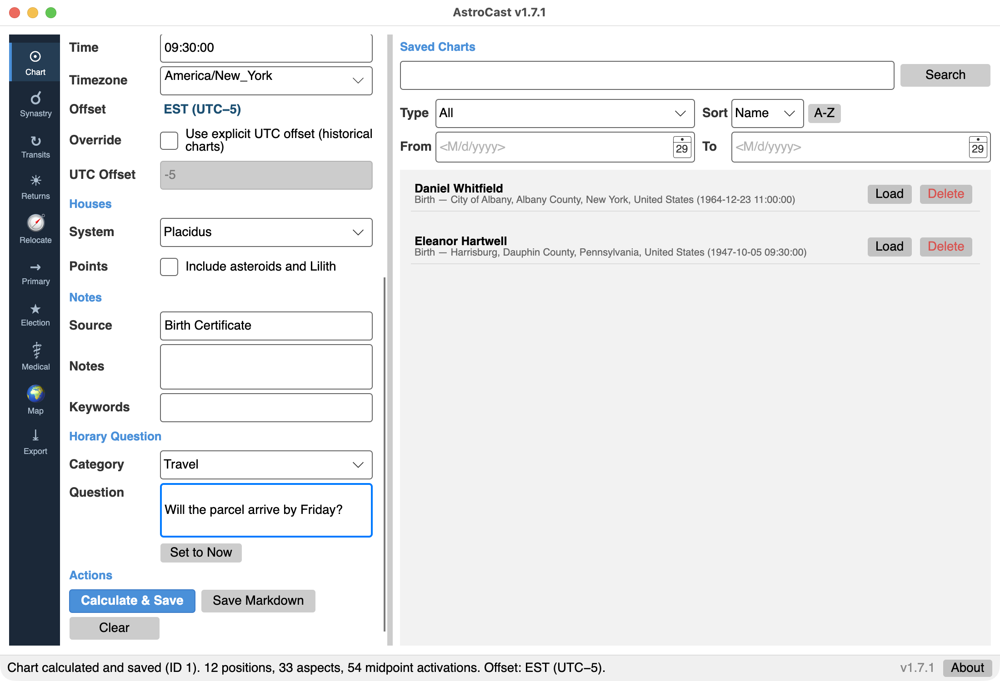

*The Chart panel with Type set to Horary: the Horary Question section appears below Notes.*

Shown when **Type** is *Horary*. Choose the **Category** that names what the question is about
(*Career*, *Money*, *Relationship*, *Love*, *Home*, *Health*, *Travel*, *Education*, *Legal*
and the rest); it decides which house signifies the matter asked about. Type the **Question**:
the first line is the question itself and any further lines are context. **Set to Now** stamps
the chart with the present moment, which is the moment a horary chart is cast for. The report
then carries a *Horary Perfection Analysis*: the significators, their aspects, receptions and
the judgment.

### Actions

**Calculate & Save** casts the chart and saves it to the database; a chart of the same name
already saved is replaced after you confirm, and a chart saved under a changed name is a new
chart, the old one staying in the list until you delete it. **Save Markdown** exports the
chart on screen. **Clear** empties the form.

### Where the chart is

The Chart panel is a form: it casts and saves, and the status bar confirms it. The chart
itself is read in its export. The Markdown report (**Save Markdown** here, or **Export
Markdown** on the Export panel) carries the positions with sign, degree, house and speed; the
house cusps; the aspects with their orbs and whether each applies or separates; the midpoints;
the essential dignities; the sect; the Moon's condition; the Arabic parts; the fixed stars on
the angles and planets; the planetary hour; the time lords; the temperament. The Export panel's
**Export PDF** lays the same out as a printable document, and **Export JSON** writes it as data.

## 5. Transits & Progressions

The **Transits** panel (Alt+3) works on the chart on the Chart panel: cast one, or load one
from the Export panel, first. It has three sections.

### Transits

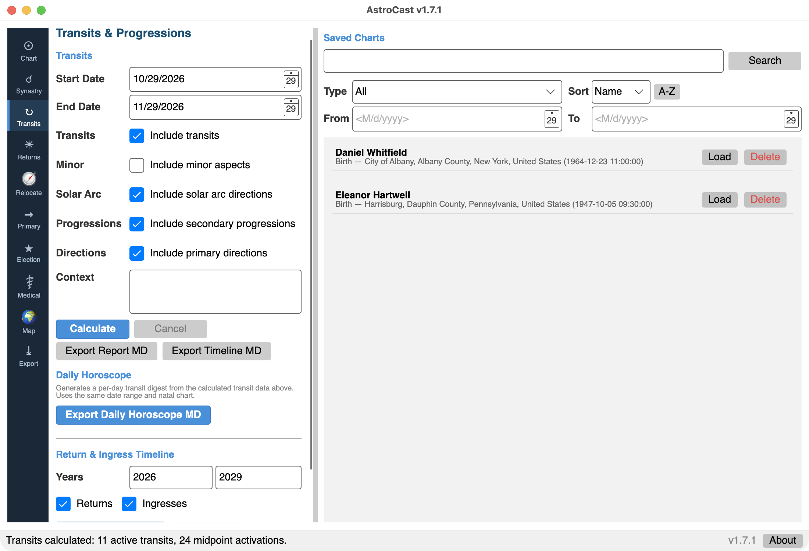

*The Transits panel after Calculate, the four technique boxes at their defaults.*

This section produces the period report: what the moving sky does to the natal chart between
two dates, by up to four techniques, in any combination.

**Start Date** and **End Date** bound the period; they open at today and a month ahead. Then
four boxes, all ticked when the program starts:

- **Transits: Include transits.** The transiting planets' aspects to the natal chart, their
  stations and sign ingresses, their passage through the natal houses, and the midpoint
  activations. Each transit is listed once as a whole passage, with its entry into orb, every
  exact pass and its exit, so a slow planet's three passes over a point appear as one transit
  with three dates.
- **Minor: Include minor aspects.** Transits only: adds the semi-square, sesquiquadrate,
  semi-sextile and quincunx to the five Ptolemaic aspects. It greys out when Transits is off.
- **Solar Arc: Include solar arc directions.** The directed positions and their aspects at the
  start date, and every solar-arc aspect that becomes exact inside the period, dated.
- **Progressions: Include secondary progressions.** The progressed positions, the progressed
  Moon, stations and aspects at the start, and the dated hits in the period.
- **Directions: Include primary directions.** The primary directions exact in the period,
  calculated with the **Primary** panel's settings (chapter 7).

**Context** is free text printed in the report's header for the prompt to read: *Focus on
career themes*, say. **Calculate** runs the report (it needs at least one technique ticked);
**Cancel** stops it. **Export Report MD** writes it. The report's title and the file name
follow the techniques it holds: *Transit Report* and `Name_Transits_start_end.md` whenever
transits are in; without them, *Solar Arc Report*, *Secondary Progressions Report*, *Primary
Directions Report* or a combination such as *Solar Arc and Progressions Report*. The header's
**Techniques** line says which.

**Export Timeline MD** writes the same period as a chronological table of events (each entry
into orb, exact pass, exit, station and ingress, dated) with clusters where events crowd
together. It needs a result with transits.

### Daily Horoscope

**Export Daily Horoscope MD** writes one entry per day of the period: the transits in orb at
noon that day, the Moon's sign and phase, the void-of-course periods and the Moon's sign
changes, each on the chart's own clock. It also needs a result with transits.

### Return & Ingress Timeline

A calendar of two kinds of event over a span of years, for the chart on the Chart panel:
**Returns**, each planet from Mercury to Saturn returning to its natal place; **Ingresses**, the
outer planets (Jupiter to Pluto, and Chiron) entering a new sign. Type the **Years**, tick what
you want, press **Calculate Timeline**, then **Export MD**. The file is named
`RI_Timeline_Name_start_end.md`.

---

## 6. Returns and the mundane series

The **Returns** panel (Alt+4) opens with the time lords of the chart on the Chart panel, then
the three kinds of return, then six mundane series that need no natal chart at all.

### Annual Profection

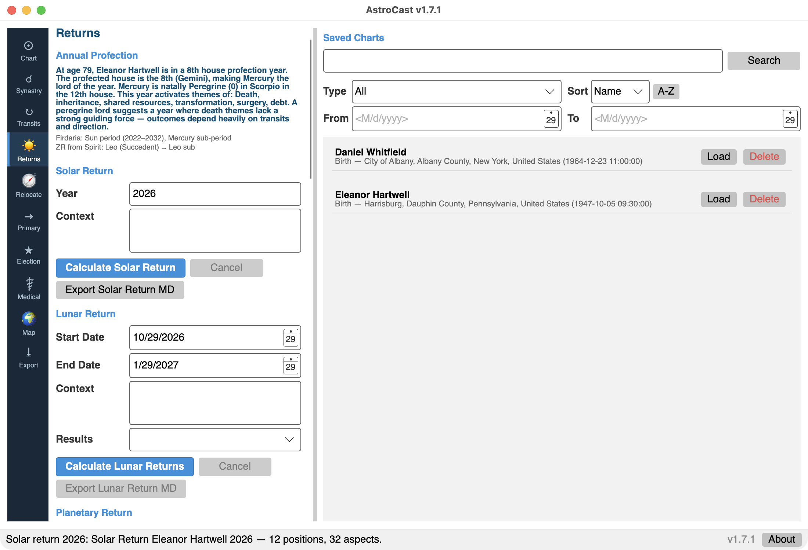

*The top of the Returns panel: the three time-lord lines and the Solar Return section after Calculate Solar Return.*

Three lines, updated whenever a chart is cast or loaded: the current **annual profection**
(the house and sign the year has reached, and the planet that rules it), the current
**firdaria** period and sub-period, and the current **zodiacal releasing** period from the Lot
of Spirit. They are also printed in the chart report. Nothing to press here.

### Solar Return

The chart of the Sun's return to its natal place, cast at the natal location. **Year** is the
calendar year wanted; *Solar Return 2026* is the return nearest the birthday in 2026. Type a
**Context** if you like, press **Calculate Solar Return**, then **Export Solar Return MD**
(`Name_SolarReturn_2026.md`). The report carries the return's details, the time lords as
they stand at the return (the annual profection, the firdaria, the zodiacal releasing), the
return chart complete, and the return chart's declination aspects to the natal chart.

### Lunar Return

The Moon returns to its natal place every 27.3 days. **Start Date** and **End Date** bound the
search (they open at today and three months ahead); **Calculate Lunar Returns** finds every
return in the range and lists them in **Results**. Pick one, then **Export Lunar Return MD**
(`Name_LunarReturn_date.md`). Each report has the same shape as the solar return's: the
return's details, the time lords at the return, the return chart, and its declination aspects
to the natal chart.

### Planetary Return

A planet returning to its natal place: Saturn's return at about 29, Jupiter's every twelve
years, and Mars, Venus and Mercury more often. Choose the **Planet** (Saturn, Jupiter, Mars,
Venus or Mercury), then **Find by**: *By Year* finds the return nearest a **Year**; *By Return
#* finds the first, second or Nth return from birth. **Calculate Return**, then **Export
Return MD** (`Name_SaturnReturn_1.md`).

A planetary return is counted as one passage of the planet over its natal degree: a direct
crossing plus the retrograde and direct crossings that follow it, if any. The report dates the
return at the first crossing and lists the others on an *Other passes* line.

**Calculate Timeline** maps the whole cycle from this return to the next through its phase
points (the squares and the opposition), with **Include snapshots** adding the positions at
each; **Export Timeline MD** writes it (`Name_SaturnCycleTimeline_1.md`).

### Mundane Location

The six series below cast their charts for a place. **Search** for a city and choose from the
results; the panel opens with Washington, DC.

### Great Conjunctions

Jupiter and Saturn meet every twenty years. Type the **Years** (1800 to 2100 by default), press
**Find Conjunctions**, then **Export Series MD** (`GreatConjunctions_1800-2100.md`): each
conjunction with its date, position, sign, element and modality, whether it marks a mutation
to a new element, the interval since the last, and the chart cast for it at the mundane
location.

### Synodic Cycles

The same for any pair: choose body **A** (the faster) and body **B** (the slower), the
**Years**, then **Find Conjunctions** and **Export Series MD**. The report follows Ebertin's
eight-phase cycle from one conjunction to the next.

### Ingress Charts

The moment a planet enters a sign. Choose the **Planet** and the **Year**; **Cardinal only**
keeps the Sun's four entries into Aries, Cancer, Libra and Capricorn, the equinoxes and
solstices. **Find Ingresses** gives the dates alone (**Export MD**,
`Sun_Ingresses_2026.md`); **Calculate Cardinal Charts** casts the four cardinal charts complete
at the mundane location (**Export Cardinal MD**, `CardinalIngresses_2026.md`).

### Lunation Charts

Every New and Full Moon of a **Year**. **Find Lunations** dates them, with each one's sign,
degree, element and modality and a *Near a node* column that marks the lunations close enough
to a lunar node to be eclipses; **Calculate Charts** casts each at the mundane location.
**Export MD** writes `Lunations_2026.md`.

### Eclipse Calculator

Every solar and lunar eclipse between two **Years**, with its category and type, its sign and
position, its distance from the node and, for a solar eclipse, the duration of the central
eclipse over the whole Earth. **Find Eclipses**, then **Export MD** (`Eclipses_2026_2030.md`).

### Mundane Aspect Finder

Every exact aspect between two bodies over a span of years: choose **Planet 1** and **Planet
2**, the **Harmonic** (45° for the full Ebertin cycle of eight phases, 90° for the four major
aspects) and the **Years**. **Find Aspects**, then **Export MD**.

Each series has its own **Cancel** button while it runs. The exports are plain Markdown
tables; the prompts P18 to P22 read them.

---

## 7. Synastry, Composite & Davison; Relocation; Primary Directions

### Synastry (Alt+2)

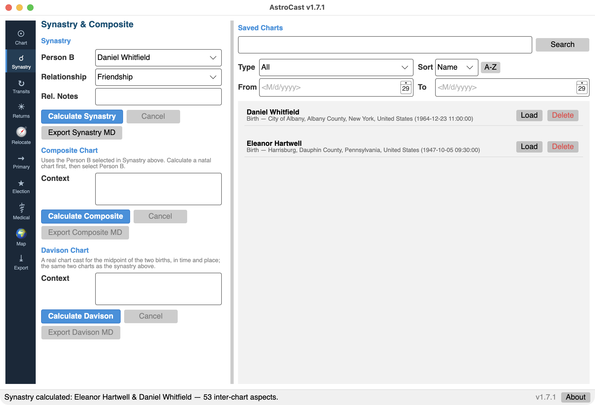

*The Synastry panel after Calculate Synastry, with Daniel Whitfield as Person B.*

The panel compares the chart on the Chart panel, **Person A**, with a saved chart you pick as
**Person B**. Choose the **Relationship** (*Romantic Partnership*, *Marriage*, *Parent & Child*,
*Siblings*, *Friendship*, *Business Partnership*, *Colleagues*, *Teacher & Student*,
*Therapist & Client*, *Adversarial*, *Other*) and, if you like, **Rel. Notes** for the prompt
(*married 15 years*). **Calculate Synastry**, then **Export Synastry MD**
(`PersonA_PersonB_Synastry.md`).

The report prints both charts, then the inter-chart aspects (each planet of A to each planet
of B, with orbs), the house overlays both ways (A's planets in B's houses and B's in A's), the
inter-chart declination aspects, and, with the Points switch on, each person's asteroids and
Lilith against the other's planets.

If Person B is an event chart rather than a person, the same export serves the event-to-natal
reading (prompt P17).

### Composite Chart

The relationship as a chart of its own, made from the midpoints of the two charts' planets.
Type a **Context** if you like, press **Calculate Composite**, then **Export Composite MD**
(`PersonA_PersonB_Composite.md`). The composite's Midheaven is the midpoint of the two
Midheavens and its houses are cast from that at the mean of the two birth latitudes, in the
house system the two charts share (Placidus if they differ); Mercury and Venus take the
midpoint nearer the composite Sun. Because a composite body is a midpoint and not a point in
the sky, the report says once, under its Method line, what it leaves out: declinations,
stations, the Moon's void of course and the like.

### Davison Chart

The relationship as a real chart: the one cast for the moment halfway between the two births
and the place halfway between the two birthplaces. **Calculate Davison**, then **Export Davison
MD** (`PersonA_PersonB_Davison.md`). The report's header gives the midpoint moment in UT and
the midpoint place; the chart that follows is complete, every section a birth chart has,
because it is cast like one. Either of the two charts may be an event.

### Relocation (Alt+9)

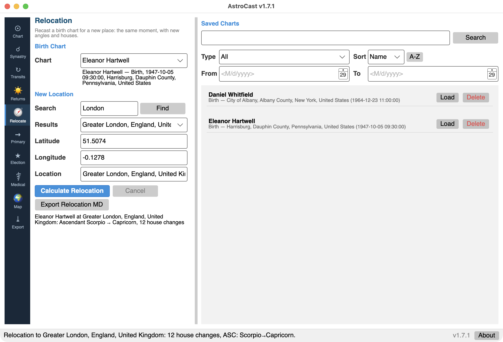

*The Relocation panel after a relocation to London: the result line names the new Ascendant and the house changes.*

What the birth chart looks like cast at another place: the same moment, new angles, new
houses. The **Birth Chart** picker follows whatever you load or calculate on the Chart panel;
a line beneath it names the chart in use. Under **New Location**, **Search** for the place and
choose it from **Results**, or type the **Latitude**, **Longitude** and **Location** yourself.
**Calculate Relocation**, then **Export Relocation MD** (`Name_Relocation_Place.md`).

The relocated chart keeps everything that belongs to the birth moment — the planets' signs and
degrees, the sect, the dignities, the planetary hour, the time lords — and recomputes
everything that depends on the horizon: the angles, the cusps, the houses, the aspects to the
angles, the angular planets, the Arabic parts and the parans. The report lists the house
changes planet by planet, and which planets became angular or left an angle. A horary chart
relocated keeps its question and is judged at the new place.

### Primary Directions (Alt+0)

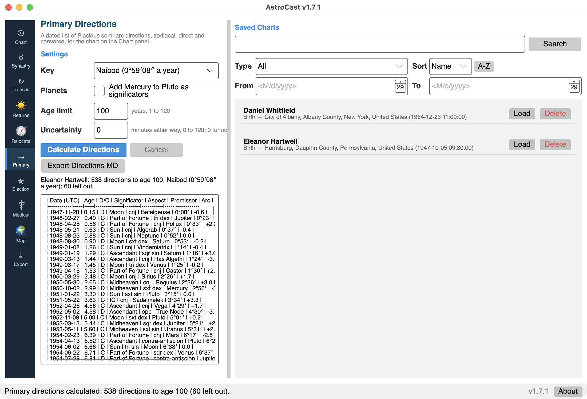

*The Primary Directions panel after Calculate Directions: the whole-life list, one row per direction.*

The oldest predictive technique: the chart's significators (the Ascendant, the Midheaven, the
Sun, the Moon and the Lot of Fortune) carried by the daily rotation to the promissors (the
planets and their aspect points, the node, the antiscia, the fixed stars), each arc of
right ascension read as a span of years. AstroCast uses the Placidus semi-arc method, in
zodiaco, with both direct and converse directions.

**Settings.** The **Key** turns an arc into years: *Naibod* (0°59′08″ a year, the default),
*Ptolemy* (1° a year) or the *True solar arc in right ascension*. **Planets: Add Mercury to
Pluto as significators** directs to the planets as well as to the angles, the lights and the
Lot. **Age limit** bounds the list (100 years by default; 1 to 120). **Uncertainty** is your
birth-time uncertainty in minutes (0 to 120): with a value, every direction gets a date
range for the birth time plus and minus that many minutes.

**Calculate Directions** lists every direction from birth to the age limit, in date order, on
the panel: the date, the age, D or C for direct or converse, the significator, the aspect,
the promissor, the arc, and *months per minute* — how far the date moves for each minute of
birth-time error, which tells you at once which directions are worth trusting with an
uncertain time. **Export Directions MD** writes the whole-life report
(`Name_PrimaryDirections_0-100.md`) with the natal chart embedded; prompt P29 reads it as a
life's chapters with rectification notes.

The Transits panel's **Directions** box uses these same settings to add the period's primary
directions to the transit report.

## 8. Election; Medical; the Map

### Election (Alt+5)

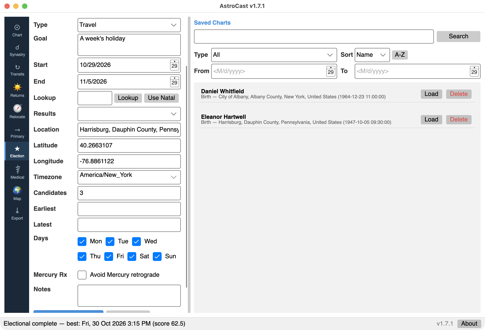

*The Election panel after a one-week search for a Travel election.*

Electional astrology chooses a moment. The panel searches a date range for the moments that
best suit an undertaking, scores every candidate against the natal chart of the person doing
it, and reports the best few.

**Natal Chart** is the chart the search scores against: it follows whatever you load or
calculate on the Chart panel, or pick a saved chart here. **Type** is the kind of undertaking
(*Business Launch*, *Contract*, *Wedding*, *Surgery*, *Real Estate Listing*, *Real Estate
Closing*, *Creative Launch*, *Travel*, *Other*); each type weighs the factors differently.
**Goal** is a sentence for the prompt (*Launch new product line*). **Start** and **End** bound
the range.

The place: **Lookup** a city, or **Use Natal** to copy the natal chart's location, or type the
**Location**, **Latitude**, **Longitude** and **Timezone** yourself. Every candidate is given on
this clock.

The constraints: **Candidates** is how many windows to report (1 to 5; three by default).
**Earliest** and **Latest** limit candidates to a span of the local day (`09:00` to `17:00`,
say; leave both empty for any time). **Days** ticks the weekdays allowed. **Mercury Rx: Avoid
Mercury retrograde** excludes the days Mercury is retrograde. **Notes** is free text for the
report.

**Calculate Electional** runs the search: every quarter-hour in the range is scored (every
half-hour when the range is longer than 90 days), and **Cancel** stops it. **Export Electional MD** writes the report
(`Name_Electional_start_end.md`): a header with the type, the goal, the range, the place, the
constraints and the score ceiling (the most the chosen type can score), then each candidate
instant with its score and breakdown, the chart cast for it, and the Moon's condition.

A search is refused when the natal chart's house system has no houses at the election's place
(Placidus or Koch inside the polar circles): choose another system on the Chart panel. Where
the Sun does not rise or set on a day of the range, those samples have no planetary hour and
are left unscored; the report says how many.

### Medical (Alt+6)

Traditional medical astrology, for education and research. The panel has one box, **Health
Context (optional)**: known conditions, symptoms or history, printed as given in the report's
header for the prompt to read. **Export Medical Report (Markdown)** writes the report for the
chart on the Chart panel (`Name_Medical.md`): the natal chart; the temperament assessment with
its elemental scores; the emphasised signs and the parts of the body they rule; the planetary
correspondences; the hard aspects of medical significance; and the health houses (the 6th, 8th
and 12th) with their cusps' correspondences. Nothing in it is a diagnosis; the prompts that
read it say so too.

### Map (Alt+8)

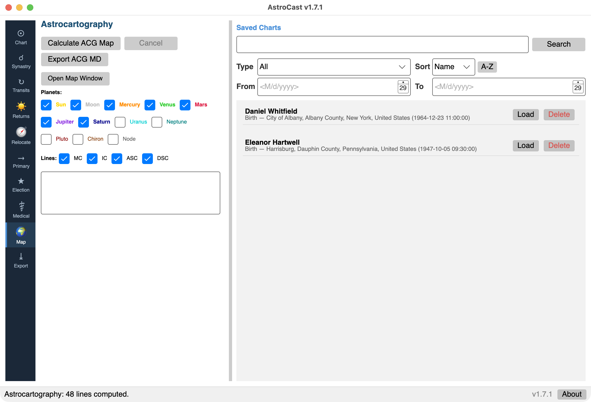

*The Map panel after Calculate ACG Map: the body and line boxes on the left.*

Astrocartography draws, for the chart on the Chart panel, the lines on the Earth where each
body was on an angle at the moment of birth: rising (ASC), setting (DSC), culminating (MC) or
anti-culminating (IC). A place on a planet's line is a place where that planet is angular in
the relocated chart.

**Calculate ACG Map** computes the lines for all twelve bodies (the status bar reports how
many) and opens the map window; **Cancel** stops it. Under **Planets** and **Lines**, tick the
bodies and the four angles you want drawn: the Sun to Saturn and all four angles are on when
the program starts, the outer planets, Chiron and the Node off. **Export ACG MD** writes every
line and crossing as a table (`Name_Astrocartography.md`). **Open Map Window** brings the map
window back if you closed it: the world with the lines drawn over it, one colour per body,
solid for MC and ASC, dashed for IC and DSC, each labelled where it leaves the top of the view.
Drag to pan, scroll to zoom. Click anywhere on the map and the bar at the bottom gives a
*Crossing Report* for that spot: every body's angular lines within 334 km, each with its
distance — all twelve bodies, whether or not their lines are drawn — so you can read a city's
astrocartography by pointing at it.

The lines are drawn *in mundo*: each follows the body's true place in the sky, latitude
included, not its zodiacal degree. A body's rising and setting lines meet at the latitude
beyond which it never rises or sets, so for a body with a large declination they end well short
of the poles; the MC and IC lines run the whole way.

**The base map.** Under the lines the window shows a street map from CARTO (map data from
OpenStreetMap), if it has a key. Without one the lines draw on a blank background and the
legend says *Base map unavailable: no CARTO key*. To add the map:

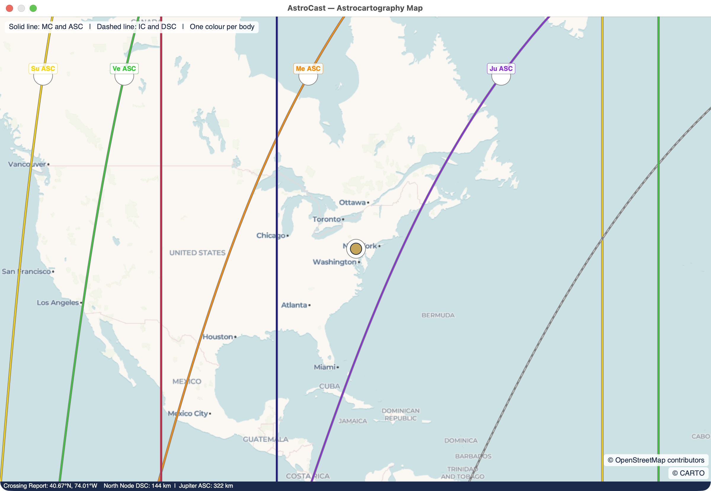

*The map window: Eleanor Hartwell's lines over the CARTO base map, with the Crossing Report for a click near New York at the bottom.*

1. Request a free key at CARTO's basemaps page (carto.com/basemaps). CARTO's terms allow free
   non-commercial use within a monthly allowance of tile requests, and require the attribution
   the map already shows.
2. Save the key, by itself, in a plain text file named `carto-key.txt`.
3. Put the file beside `AstroCast.exe` on Windows (`%LOCALAPPDATA%\Thornhill Computer
   Software\AstroCast`), or in `~/Library/Application Support/AstroCast` on macOS.
4. Start AstroCast again. The map window now draws the tiles; the only internet traffic is the
   tile requests, sent as you pan and zoom.

The key is yours and stays on your machine; AstroCast never writes it anywhere else.

---

## 9. Export & Backup (Alt+7)

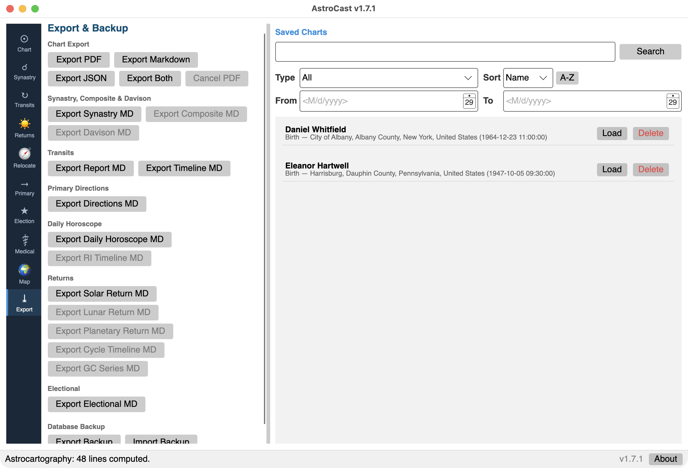

*The Export panel: every export in one place, the Saved Charts list beside it.*

The **Export** panel gathers every export in one place; the **Saved Charts** list beside it is
the same list every panel shows. The panel is tall: on a small window, scroll it to reach the
**Database Backup** buttons at the bottom.

### Chart Export

For the chart on the Chart panel: **Export PDF** lays the chart out as a printable document
(the same content as the Markdown, with the planetary hour and, for a horary chart, the
perfection analysis); **Export Markdown** is the same as the Chart panel's Save Markdown;
**Export JSON** writes the chart as data (positions to four decimal places), for a program or
an AI that wants numbers rather than prose; **Export Both** writes the PDF and the Markdown
together, naming the Markdown after the PDF you chose and asking before it overwrites one that
exists. **Cancel PDF** stops a long PDF.

### The other exports

The groups that follow repeat the export buttons of the other panels, each enabled once its
panel has a result: **Synastry, Composite & Davison**; **Transits** (Export Report MD, Export
Timeline MD); **Primary Directions**; **Daily Horoscope**; **Returns** (the solar and lunar
returns, the planetary return and its cycle timeline, the Great Conjunction series, and the
return-and-ingress timeline as *Export RI Timeline MD*); **Electional**. They do what their
panels' buttons do.

### Database Backup

**Export Backup** writes every saved chart to one JSON file (`AstroCast_Charts_date.json`) for
safekeeping or to carry to another machine. **Import Backup** reads such a file back: a chart
whose name matches one already saved is updated, a new name is added; it asks before it
starts. This is how to move your charts between the Windows and macOS versions, whose
databases are separate.

### Saved Charts

The right half of the window, on every panel, lists every chart in the database: its name,
its type, its place and its date. **Search** by name; filter by **Type**; **Sort** by name,
date, type or when it was saved, with the **A-Z** button reversing the order; **From** and
**To** limit the list to a span of birth dates. Each row has its own **Load**, which brings the
chart back to the Chart panel and makes it the chart every other panel works on, and
**Delete**, which removes it after a confirmation; there is no undo.

### File names

Every export proposes a file name from the chart and what the report holds, so a folder of
exports sorts by person: `Eleanor_Hartwell.md`, `Eleanor_Hartwell_Transits_2026-01-01_2026-02-01.md`,
`Eleanor_Hartwell_SolarReturn_2026.md`, `Eleanor_Hartwell_Daniel_Whitfield_Synastry.md`,
`Eleanor_Hartwell_PrimaryDirections_0-100.md`. Characters a file system refuses are replaced.
You can change the name in the dialog.

---

## 10. The rules you will meet

A few of AstroCast's rules show up in ordinary use. Knowing them saves surprises.

**Dates run from 1200 to 2399.** The ephemeris files shipped with the program cover 1200-01-01
to 2399-12-31; a date outside that span is refused with a message that says so.

**Before 15 October 1582 the calendar is Julian.** AstroCast reads a date before 1582-10-15 as a
Julian-calendar date and prints every date before then on the Julian calendar, as the people
of the time wrote them. The ten days 1582-10-05 to 1582-10-14 never occurred and are refused.
A report that holds such a date carries a *Calendar* line saying so.

**Times are read on the zone in force.** A time zone's rules, daylight-saving and all, come from
the IANA database the program carries, so the same chart casts the same on both systems. When
a reading is ambiguous the chart is cast by a fixed rule and the report's *Time Note* says
which (chapter 4). When you know the clock's offset from the record, the explicit offset gives
exactly that.

**Placidus and Koch stop at the polar circles.** Inside them those systems have no houses; a
chart there, and an electional search there, is refused with a message naming the system.
Choose *Equal* or *Whole Sign* on the Chart panel.

**The Points switch is for the session.** Asteroids and Lilith are off every time the program
starts, never saved with a chart, and ticked on or off for all panels at once.

**Every long calculation can be cancelled.** Each panel's **Cancel** button stops its own
calculation and leaves the last result where it was. The status bar reports progress while a
search runs.

**The two versions differ in a few small ways.**

- *Where the database lives.* On Windows it sits beside the program; on macOS in `Application
  Support`. Carry charts between them with Export Backup and Import Backup.
- *The application menu.* On macOS the menu bar's **AstroCast** menu has *About AstroCast*,
  which opens the same About window as the status bar's button.

  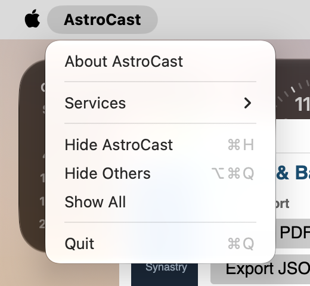
- *The save dialog.* On macOS, saving to a place that has no ordinary file path (a cloud
  location the Finder shows but the file system does not) is treated as a cancel; save to a
  folder and copy from there.
- *The map window* draws the same lines and tiles on both, through two different map libraries;
  the controls are the same.

**Everything is calculated afresh.** No position is stored; a saved chart holds its input and is
recalculated every time it is loaded. That is why a chart saved by an older version recasts
under the current engine's rules when you load it.

---

## Appendix: the exports and the prompts that read them

AstroCast's reports are written to be read by the prompts of its companion library, one per
kind of report. The prompt library has a guide of its own, the
[Prompt Library Guide](PROMPT_LIBRARY_GUIDE.md); this table is the map from an export to its
prompt.

| Export | Where it is made | Prompt |
|---|---|---|
| Chart (Type: Birth), Markdown | Chart: Calculate & Save, Save Markdown | P01 (full natal reading), P02 (shorter), P26 (factual chart PDF), P27 (chart wheel) |
| Chart JSON | Export: Export JSON | P26, P27 |
| Horary chart | Chart with Type: Horary | P15 |
| Event chart | Chart with Type: Event or a named kind | P16 (the event's own chart), P25 (decumbiture), P27 |
| Synastry | Synastry: Export Synastry MD | P12; P17 when one chart is an event; P27 |
| Composite | Synastry: Export Composite MD | P13, P27 |
| Davison chart | Synastry: Export Davison MD | P30 |
| Transit Report (transits ticked) | Transits: Export Report MD | P03, P04, P27 |
| Solar Arc / Progressions / Primary Directions report of a period | Transits: Export Report MD with transits unticked | P28 |
| Transit Timeline | Transits: Export Timeline MD | P04; with the Medical export, P24 |
| Daily Horoscope | Transits: Export Daily Horoscope MD | P05 |
| Return & Ingress Timeline | Transits: Calculate Timeline, Export MD | P10 |
| Solar Return | Returns: Export Solar Return MD | P06, P27 |
| Lunar Return | Returns: Export Lunar Return MD | P07, P27 |
| Planetary Return | Returns: Export Return MD | P08, P27 |
| Planetary Cycle Timeline | Returns: Export Timeline MD | P09 |
| Mundane Aspect Series | Returns: Mundane Aspect Finder, Export MD | P18 |
| Great Conjunction Series | Returns: Export Series MD | P19 |
| Ingress Series, or the four cardinal charts | Returns: Ingress Charts | P20 |
| Lunation Series | Returns: Lunation Charts, Export MD | P21 |
| Eclipse Series | Returns: Eclipse Calculator, Export MD | P22 |
| Relocation | Relocate: Export Relocation MD | P11, P27 |
| Primary Directions Report, whole life | Primary: Export Directions MD | P29 |
| Electional Report | Election: Export Electional MD | P14; P27 for each candidate |
| Medical | Medical: Export Medical Report (Markdown) | P23; with the Transit Timeline, P24 |

No prompt reads the astrocartography export, the Synodic Cycles series, the chart PDF or the
database backup.

A report from the Transits panel is routed by its header: a *Techniques* line that names
Transits goes to P03; one without goes to P28. The Primary panel's whole-life report, whose
header has a *Span* line, goes to P29.
